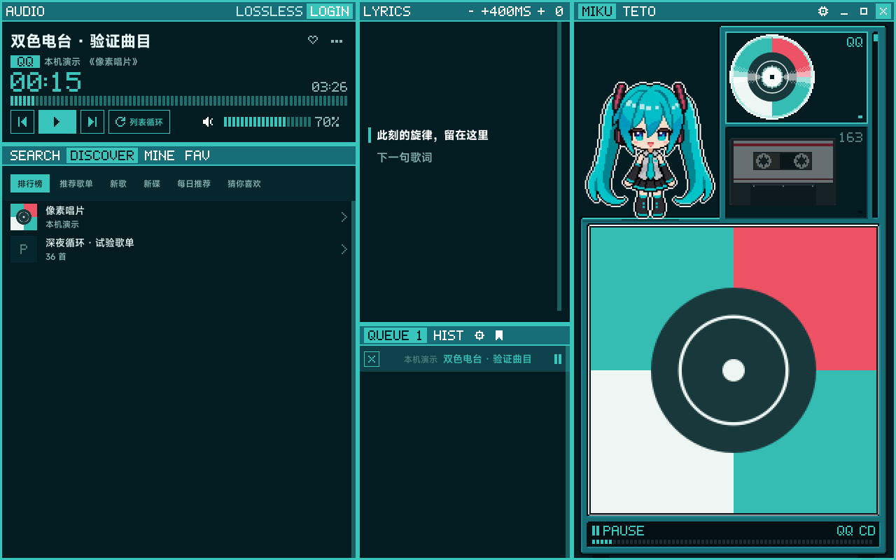
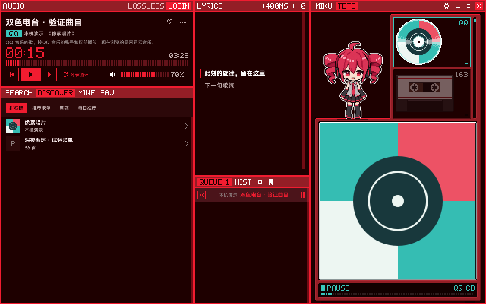

# Miku Teto Music

**两个平台，一条队列。**

Windows 原生桌面音乐播放器，把 QQ 音乐和网易云音乐放进同一个窗口。

<table>
  <tr>
    <td width="50%"></td>
    <td width="50%"></td>
  </tr>
  <tr>
    <td align="center"><b>MIKU</b>：浏览 QQ 音乐</td>
    <td align="center"><b>TETO</b>：浏览网易云音乐</td>
  </tr>
</table>

[下载](#下载) &nbsp;|&nbsp; [主题](#两个主题一条队列) &nbsp;|&nbsp; [功能](#功能) &nbsp;|&nbsp; [隐私](#隐私与本地数据) &nbsp;|&nbsp; [构建](#从源码构建) &nbsp;|&nbsp; [许可](#许可与致谢)

有的歌在 QQ 音乐，有的歌在网易云音乐。Miku Teto Music 把它们排进同一条队列，一首接一首地播放，不用在两个客户端之间来回切换。每首歌仍然通过它自己的平台和你自己的账号播放。

> **维护说明：** 本项目为个人兴趣项目，维护和更新频率较低，平时很少查看 Issue，不保证及时回复或处理。

## 下载

需要 Windows 10 或 Windows 11（x64）。这是便携版，解压后即可运行。

1. 打开 [最新版本](https://github.com/pishcolin/MikuTeto-Music/releases/latest)，下载 `MikuTeto-Music-1.0.0-Windows-x64.zip`。
2. 解压到一个文件夹，保持里面的文件在一起。
3. 运行 `MikuTetoMusic.exe`，用手机扫码登录你要使用的平台。

## 两个主题，一条队列

主题决定你正在逛哪个平台，歌曲从哪里播放则由歌曲自己决定。

| | 跟随什么 |
| :--- | :--- |
| 搜索、发现、账号页面 | 当前主题：MIKU 是 QQ 音乐，TETO 是网易云音乐 |
| 正在播放的歌曲 | 歌曲自己的平台，切换主题不会改变 |
| 播放队列、收藏、本地歌单 | 两个平台共用 |
| 点歌曲旁的心形 | 同时更新本地收藏和这首歌所属的平台 |

QQ 音乐的歌进 CD 仓，网易云音乐的歌进磁带仓。所以在 MIKU 主题下听网易云的歌时，亮起的是磁带仓。

## 功能

**找歌**
- 按歌曲、专辑、歌单和歌手搜索，也可以逛发现页。
- 两个平台的浏览位置分别保留，切换主题后可以接着看。

**播放**
- 一条队列混合两个平台的歌曲，可以调整顺序、定位当前歌曲。
- 显示同步歌词。
- 播放中断后可以恢复。

**收藏与歌单**
- 已登录平台里喜欢的歌会自动导入本地收藏。
- 点心形时，本地状态和歌曲所属平台一起更新。
- 离线或登录过期时，改动会先留在本地并标记为待同步。你可以查看状态并重试，冲突保护会避免改动写到错误的账号。
- 可以把当前队列存成命名的本地歌单，两个平台的歌可以放在一起。

## 使用范围

> [!IMPORTANT]
> 能否播放一首歌，取决于你的平台账号、所在地区和这首歌的版权。

Miku Teto Music 是第三方播放器，不改变你在平台上的权益：

- 不绕过 VIP 限制。
- 不提供音乐下载。
- 不会自动到另一个平台寻找替代版本。

## 隐私与本地数据

- 本地曲库保存在 SQLite 数据库里，运行数据保存在本机的 `runtime/data` 配置目录。
- 保存的登录凭据由 Windows DPAPI 保护。
- GitHub 发布包不包含任何个人凭据或个人曲库。
- 搜索、登录和播放请求仍会发往你使用的音乐平台。

## 技术结构

| 部分 | 技术 | 职责 |
| :--- | :--- | :--- |
| 界面 | Qt Quick / QML，Python + PySide6 | 窗口、主题和交互 |
| 播放服务 | 独立的 C++ Qt 进程 | 音频播放，独立于界面运行 |
| 平台桥接 | 本地 Node 进程 | 连接 QQ 音乐和网易云音乐 |

## 从源码构建

构建步骤见 [docs/BUILDING.md](docs/BUILDING.md)，上游来源见 [docs/UPSTREAM.md](docs/UPSTREAM.md)。

每个版本同时发布源码、Windows ZIP 和第三方源码 ZIP。

## 许可与致谢

| 内容 | 授权 | 详情 |
| :--- | :--- | :--- |
| 本项目自有代码 | MIT，© 2026 pishcolin | [LICENSE](LICENSE) |
| Rhine-Music-Database 上游代码 | MIT，© 2026 LBEILC | [LICENSE-Rhine.txt](LICENSE-Rhine.txt) |
| 捆绑的第三方代码和字体 | 各自的许可证 | [THIRD_PARTY_NOTICES.md](THIRD_PARTY_NOTICES.md)、[licenses/](licenses/) |
| MIKU / TETO 角色素材 | 不适用 MIT，受角色指南约束 | [ASSET-NOTICE.txt](ASSET-NOTICE.txt) |

MIT 许可不会重新授权捆绑的第三方代码、字体或角色权利。

本项目基于 [MikeQu223/Rhine-Music-Database](https://github.com/MikeQu223/Rhine-Music-Database/tree/15139d4b3562edcf3d9b24b50ca502bd42f784d7)，固定在提交 `15139d4b3562edcf3d9b24b50ca502bd42f784d7`。感谢 LBEILC 和 [RhineLabUI](https://github.com/LBEILC/RhineLabUI)。

<b>主要第三方组件</b>

 

这里只列主要组件。完整声明见 [THIRD_PARTY_NOTICES.md](THIRD_PARTY_NOTICES.md)，对应的第三方源码包随版本发布。

| 组件 | 许可证 |
| :--- | :--- |
| Qt / PySide6 | LGPL-3.0 |
| FFmpeg | LGPL-2.1-or-later |
| Node.js、Python | 各自的许可证 |
| QQ Music API | 见第三方声明 |
| NeteaseCloudMusicApiEnhanced | 见第三方声明 |
| YesPlayMusic | MIT |
| LyricsKit（部分代码） | MPL-2.0 |
| @unblockneteasemusic/server | LGPL-3.0（位于打包的依赖树内） |
| MiSans | MiSans 自身的许可证（官方原版字体，未修改） |
| Noto Sans Symbols 2 | OFL-1.1 |

## 角色声明

界面中的 MIKU 和 TETO 像素形象是 AI 辅助制作的同人素材，不适用 MIT 许可，分别受各自的角色指南约束。

- Hatsune Miku © Crypton Future Media, INC. [www.piapro.net](https://www.piapro.net) 
  [角色使用指南](https://piapro.jp/license/character_guideline)、[PIAPRO CHARACTER LICENSE](https://piapro.jp/license/pcl)
- Kasane Teto © 線・小山乃舞世 / ツインドリル 
  [角色使用指南](https://kasaneteto.jp/guideline/character.html)

这是免费的非官方同人项目，与 QQ 音乐、网易云音乐及上述角色的权利方没有隶属或背书关系。本项目不对角色素材的商业使用作任何授权或承诺。
